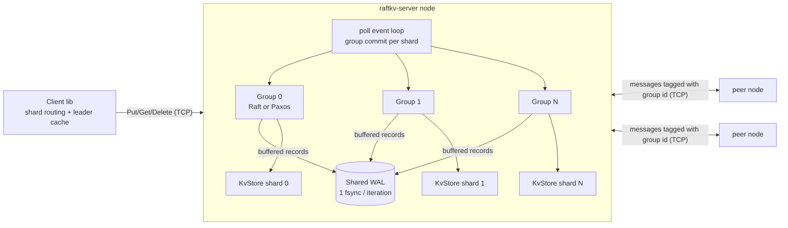

# raftkv

A sharded, fault-tolerant, replicated key-value store in C++20 with **two
independent consensus protocols, [Raft](https://raft.github.io/raft.pdf) and
[Multi-Paxos](https://lamport.azurewebsites.net/pubs/paxos-simple.pdf)**, behind
one interface, verified by a deterministic fault-injection simulator, a
**Jepsen-style linearizability checker**, and mutation testing.

Keys are hash-partitioned across many independent consensus groups
(multi-Raft / multi-Paxos), all groups on a node share one write-ahead log,
logs are compacted into snapshots, and Raft serves linearizable reads with
ReadIndex. Writes are acknowledged only after a majority has them on disk, so
the cluster keeps serving and loses no acknowledged data when a minority of
nodes crash.

```
$ SHARDS=8 scripts/cluster.sh start        # 3 nodes x 8 Raft groups on localhost
$ raftkv-cli --cluster $C --shards 8 put user:42 alice
OK
$ scripts/cluster.sh kill 1                # SIGKILL a node (it led ~1/3 of the shards)
$ raftkv-cli --cluster $C --shards 8 get user:42    # its shards fail over in ~300 ms
alice
```

## Highlights

**Consensus**
- **Raft from scratch**: randomized elections, log replication with conflict
  back-off, the election restriction (§5.4.1), the current-term commit rule
  that prevents the *Figure 8* anomaly (§5.4.2), plus **pre-vote** and
  **check-quorum** (as in etcd).
- **Multi-Paxos from scratch**: unique ballots, phase-1 recovery of the
  highest-ballot accepted value per slot, no-op hole filling, a stable leader
  that skips phase 1 per command, and streamed, batched phase 2.
- **One interface**: both are pure deterministic state machines
  (`ConsensusNode`); the same server, simulator, and checkers run either one.

**Scale-out**
- **Sharding**: keys are hash-partitioned (FNV-1a) across N consensus groups
  per cluster; leaders of different groups land on different nodes; clients
  route each key to its shard's leader and cache it.
- **Shared node WAL**: all groups on a node append to one log and the node
  issues **one fdatasync per event-loop iteration** (as in TiKV's raft-engine),
  with a single durability barrier before any message or reply leaves.
- **Snapshots and log compaction** for both protocols: snapshot transfer to
  lagging or restarted followers, and WAL garbage collection that rewrites the
  file down to live state.
- **ReadIndex reads** (Raft): Gets confirm leadership with one heartbeat round
  instead of writing to the log.

**Correctness**
- Crash-safe storage: per-record CRC32, torn-write detection and truncation,
  atomic file replacement (temp → fsync → rename → fsync dir).
- Exactly-once client retries via `(client_id, seq)` sessions, which survive
  snapshots.
- Deterministic fault injection, linearizability checking of 900K+ client
  operations, and 12 planted bugs that the tests must catch.

## Architecture



**Core design decision:** each protocol (`RaftNode`, `PaxosNode`) is a pure,
deterministic state machine with no I/O, threads, or clocks. It consumes
`Tick()`, `Step(message)`, `ProposeBatch(commands)`, and `RequestRead(ctx)`,
and produces outgoing messages, committed entries, snapshots to restore, and
confirmed reads. The same code runs in the TCP server and in the simulator, so
the logic tested under chaos is exactly the logic in production.

**One event-loop iteration:** read sockets → step messages into their groups →
group-commit client writes per shard → tick → **one WAL fdatasync** → send
messages, apply committed entries, answer clients, serve confirmed reads →
compact logs and garbage-collect the WAL when due.

### Raft vs. Multi-Paxos in this codebase

| | Raft (`src/raft/`) | Multi-Paxos (`src/paxos/`) |
|---|---|---|
| Leadership | Term; elected by votes; only up-to-date logs can win; pre-vote + check-quorum | Ballot `(round, node_id)`; any node can win phase 1 |
| Recovering uncommitted entries | Leader's log is authoritative; followers truncate conflicts | New leader re-proposes the **highest-ballot** accepted value per slot |
| Log structure | Contiguous; *log matching* via `(prev_index, prev_term)` | Independent slots, overwritable by higher ballots; holes become no-ops |
| Commit rule | Majority stores an entry **from the current term** (Figure 8) | Majority accepts a slot at the leader's ballot |
| Snapshots | InstallSnapshot to followers behind the leader's snapshot | Same, **plus** a new leader adopts the newest snapshot found in promises |
| Reads | ReadIndex (no log write) | Through the log |
| Durable state | `term`, `voted_for`, log, snapshot | `promised` ballot, per-slot `(ballot, value)`, snapshot |

## Testing

```
$ ./build/raftkv-tests
...
  raft chaos: 200 seeds x 5000 ticks, 2365 crashes, 2927 partitions, 1918 leader elections, 253150 entries committed, 0 safety violations
  paxos chaos: 200 seeds x 5000 ticks, 2365 crashes, 2927 partitions, 2649 leader elections, 279154 entries committed, 0 safety violations
  raft chaos + compaction: ..., 251586 entries committed, 5647 snapshots restored/installed, 0 safety violations
  paxos chaos + compaction: ..., 279362 entries committed, 6118 snapshots restored/installed, 0 safety violations
  raft linearizability: 100 seeds, 157047 client operations under faults, all histories linearizable
  paxos linearizability: 100 seeds, 161271 client operations under faults, all histories linearizable
  raft linearizability + compaction: 100 seeds, 158644 client operations ..., all histories linearizable
  paxos linearizability + compaction: 100 seeds, 160378 client operations ..., all histories linearizable
  raft linearizability + compaction + ReadIndex reads: 100 seeds, 151363 client operations ..., all histories linearizable
  raft linearizability + ... ReadIndex reads (no pre-vote/check-quorum): 100 seeds, 140174 client operations ..., all histories linearizable
63 passed, 0 failed
```

In total: **1.06M committed entries** and **929K client operations** checked
under faults, with zero safety violations and every history linearizable.

| Layer | What is tested |
|---|---|
| Codec | Round trips; every truncated prefix and garbage input rejected; byte-at-a-time framing; FNV-1a test vectors and shard balance |
| Storage (all engines) | Reopen; truncate+append; **torn write at every byte offset**; CRC detects a flipped byte; snapshot + crash between "write snapshot" and "rewrite log"; shared WAL replay of interleaved groups, unsynced records not durable, checkpoint GC shrinks the WAL |
| Scenarios (**both protocols**) | Election, replication, leader crash + failover, isolated leader can't commit, follower catch-up, **catch-up via snapshot**, restart from own snapshot |
| Raft-specific | Vote persistence, stale-log candidate rejected, **Figure 8** replayed message by message, **pre-vote** stops a rejoining node from disrupting the leader, **check-quorum** demotes an isolated leader, ReadIndex serves reads without log writes |
| Paxos-specific | Recovers a chosen value it never saw; highest ballot wins; holes become no-ops; promise survives restart; dueling proposers; **leader adopts a snapshot from a promise** |
| **Chaos** | 5-node clusters, 5% message loss (up to 30%), duplication, 1–4 tick reordering delays, partitions, crash/restart, optional aggressive compaction; checks *election safety* and *state machine safety* every tick, then liveness and convergence |
| **Linearizability** | 6 concurrent clients doing Put/Get/Delete with retries against any node that believes it is leader (including deposed leaders), under the same faults, with and without compaction and ReadIndex |

**Do the tests catch real bugs?** Every safety rule was validated by mutation
testing: plant the bug, confirm a test fails, restore.

| Planted bug | Caught by |
|---|---|
| Raft: vote without the election restriction | Raft chaos (seed 1) |
| Raft: commit old-term entries by counting replicas (Figure 8) | Figure 8 test |
| Paxos: new leader ignores recovered values | 3 Paxos tests + Paxos chaos (seed 1) |
| Paxos: recovery picks the *lowest* ballot | Highest-ballot test + Paxos chaos (seed 7) |
| Paxos: acceptor accepts lower ballots | Promise test + Paxos chaos (seed 2) |
| Paxos: new leader ignores snapshots in promises | Snapshot-adoption test + Paxos chaos with compaction (seed 1) + linearizability with compaction |
| Snapshot install keeps a conflicting log suffix | Storage test |
| KV snapshot omits the dedup sessions | KV snapshot test (the randomized campaigns did **not** hit this in 40 seeds; it needs a retry to land right after a snapshot install) |
| KV: retry deduplication disabled | KV tests + linearizability (seed 1, both protocols) |
| ReadIndex: no quorum confirmation | Linearizability without leader lease (seed 4) |
| ReadIndex: served before the leader's first commit in its term | Linearizability with ReadIndex (seed 6) |
| Reads served from local state (no ReadIndex at all) | Linearizability checker flags stale reads |

A subtlety the mutation tests surfaced: with pre-vote and check-quorum on,
dropping ReadIndex's quorum confirmation was **not** caught. Together they act
like a leader lease: an isolated leader steps down before the rest of the
cluster can elect a new one. That holds only while clocks behave (always true
in a simulator), so a second ReadIndex campaign runs with both disabled; there,
the planted bug is caught.

**Bugs found during development** (not planted):
- **Paxos write amplification**: acceptors re-persisted entries the leader
  re-sent while pipelining, growing the log to 3 GB in one benchmark (Raft's
  was 13 MB). Fixed by skipping slots already accepted at the same ballot.
- **Sharding made throughput worse** (see Performance): one log file per group
  meant up to N serialized fsyncs per loop iteration. Fixed with the shared WAL.
- **Wrong FNV-1a constant**: a mistyped offset basis still hashed, but not to
  the published standard; the test-vector check caught it.

Also:
- `scripts/failover_test.sh` (`PROTOCOL`, `SHARDS`, `WAL`, `SNAPSHOT_EVERY`):
  real 3-process cluster; SIGKILLs the node leading shard 0, verifies failover
  and no data loss, writes 300 more keys while it's down, restarts it, and
  checks it catches up (via snapshots when compaction is on).
- `-DRAFTKV_SANITIZE=ON`: AddressSanitizer + UBSan; the full suite passes clean.
- `RAFTKV_CHAOS_SEEDS=1000` / `RAFTKV_LIN_SEEDS=500` run longer campaigns.

## Performance

All numbers come from **one 2-vCPU Linux VM running all 3 nodes and the load
generator**, 64 concurrent clients, 100-byte values, every write fsync'ed
before acknowledgement (fdatasync ≈ 180 µs on this disk). Medians of 2–3 runs;
run-to-run variance on this shared VM was up to about 30%.

**Write throughput vs. shard count (Raft).** Per-group logs vs. the shared WAL:

| Shards | Per-group WAL | p99 | Shared WAL | p99 |
|---|---|---|---|---|
| 1 | 18,313 writes/s | 16.5 ms | 18,627 writes/s | 11.4 ms |
| 4 | 11,231 writes/s | 15.3 ms | 17,129 writes/s | 7.3 ms |
| 8 | 7,251 writes/s | 25.3 ms | 15,522 writes/s | 14.5 ms |
| 16 | 6,214 writes/s | 21.3 ms | **19,401 writes/s** | **7.3 ms** |

With a log file per group, adding shards made the system **slower**: profiling
showed about 47% iowait with server processes at 20–30% CPU, because every group
fsynced its own file one after another. The shared WAL brings 16 shards from
6.2K to 19.4K writes/s (**3.1x**) and keeps throughput flat as shards grow.

Honest limit: on **one machine**, sharding cannot raise *total* throughput,
because all three "nodes" share the same 2 cores and 1 disk. What sharding
provides is spreading leadership across nodes (each node leads about 1/3 of the
groups) so that, on separate machines, aggregate capacity grows with the
cluster. Measuring that requires real multi-machine hardware.

**Reads (90% Get, 1 shard):**

| Read path | Throughput | p99 |
|---|---|---|
| Raft + ReadIndex | 24,202 ops/s | 7.15 ms |
| Raft, reads through the log (`--no-read-index`) | 21,204 ops/s | 9.26 ms |
| Multi-Paxos, reads through the log | 18,030 ops/s | 11.70 ms |

**Raft vs. Multi-Paxos writes (1 shard, per-group WAL, 3-run medians):**

| Clients | Raft | Paxos |
|---|---|---|
| 1 | 2,108 writes/s | 2,019 writes/s |
| 8 | 5,964 writes/s | 5,672 writes/s |
| 64 | 22,929 writes/s | 21,740 writes/s |

Once a stable leader exists, Multi-Paxos skips phase 1 and its phase 2 is one
round trip, like Raft's AppendEntries, so the two are close.

**Pre-vote under chaos** (200 identical fault-injection seeds): Raft held **19%
fewer elections** (2,374 → 1,918), and the linearizability campaign completed
**12% more client operations** (140K → 157K), because rejoining nodes no longer
force pointless elections.

**Failover:** about 300 ms from SIGKILL of a leader to the first successful
write, for both protocols, with 1 or more shards.

## Build and run

Requires a C++20 compiler (GCC 11+ / Clang 14+), CMake 3.16+, Linux or macOS.

```bash
cmake -S . -B build -DCMAKE_BUILD_TYPE=Release
cmake --build build -j
./build/raftkv-tests                              # all tests (~90 s)
SHARDS=4 SNAPSHOT_EVERY=40 ./scripts/failover_test.sh

SHARDS=8 scripts/cluster.sh start                 # 3 nodes, 8 Raft groups each
# PROTOCOL=paxos SHARDS=8 scripts/cluster.sh start
C=$(scripts/cluster.sh spec)
./build/raftkv-cli --cluster "$C" --shards 8 put hello world
./build/raftkv-cli --cluster "$C" --shards 8 get hello
./build/raftkv-cli --cluster "$C" --shards 8 bench --ops 20000 --clients 64 --reads 90
scripts/cluster.sh stop
```

Server flags: `--protocol raft|paxos`, `--shards N`, `--wal shared|per-group`,
`--snapshot-every N`, `--no-read-index`, `--tick-ms MS`.

## Code layout

```
src/consensus/consensus.h       ConsensusNode interface (both protocols)
src/raft/raft_node.*            Raft: elections, pre-vote, check-quorum, replication,
                                snapshots, ReadIndex
src/raft/storage.h              Raft storage interface + in-memory engine
src/paxos/paxos_node.*          Multi-Paxos: ballots, phase-1 recovery, phase 2, snapshots
src/paxos/paxos_storage.*       Acceptor storage (in-memory and per-group files)
src/storage/node_wal.*          Shared per-node WAL for all groups, checkpoint GC
src/storage/file_storage.*      Per-group Raft log files (kept for comparison)
src/storage/fs_util.*           Atomic writes, checksummed records
src/kv/kv_store.*               Replicated state machine, sessions, snapshots
src/common/shard.h              Hash partitioning
src/net/server.*                poll() event loop hosting N groups per node
src/net/client.*                Shard routing, leader caching, retries
tests/sim_cluster.h             Deterministic fault-injecting simulator
tests/linearizability.h         Wing-Gong linearizability checker
tests/test_*.cpp                Unit, scenario, protocol, chaos, linearizability tests
```

## Limitations and next steps

- **Single-machine benchmarks only.** Scale-out needs a multi-machine run.
- **Static sharding**: the shard count is fixed at startup; there's no
  resharding, shard splitting, or rebalancing of leaders and replicas.
- **No cross-shard transactions** (would need 2PC on top of the groups, as in
  Spanner).
- **Static membership**: no joint-consensus reconfiguration.
- **No lease reads**: ReadIndex still costs a heartbeat round; leases would
  remove it but depend on bounded clock drift.
- **Paxos has no pre-vote equivalent**, and reads go through the log.
- **Snapshots are full copies** sent in one message (fine for this store's
  size; large state would need chunked, streaming transfer).

How this would look at Google scale: thousands of groups per node, placement
and rebalancing by a central placement service, leases for local reads,
streaming snapshots, and transactions across groups, which is the architecture
of Spanner (Paxos groups per split), CockroachDB, and TiKV (Raft groups per range).

## References

- Diego Ongaro and John Ousterhout, *In Search of an Understandable Consensus Algorithm* (Raft), USENIX ATC 2014.
- Diego Ongaro, *Consensus: Bridging Theory and Practice*, PhD thesis, 2014 (pre-vote §9.6, ReadIndex §6.4, client sessions ch. 6).
- Leslie Lamport, *Paxos Made Simple*, 2001.
- Tushar Chandra, Robert Griesemer, Joshua Redstone, *Paxos Made Live: An Engineering Perspective*, PODC 2007.
- James C. Corbett et al., *Spanner: Google's Globally-Distributed Database*, OSDI 2012.
- Maurice Herlihy and Jeannette Wing, *Linearizability*, 1990; Jeannette Wing and Chun Gong, *Testing and Verifying Concurrent Objects*, 1993.
